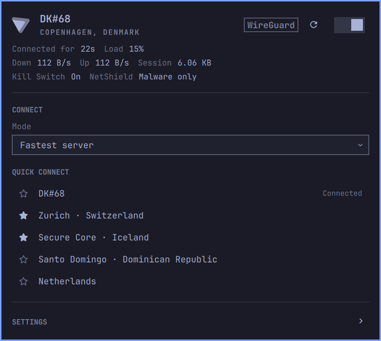
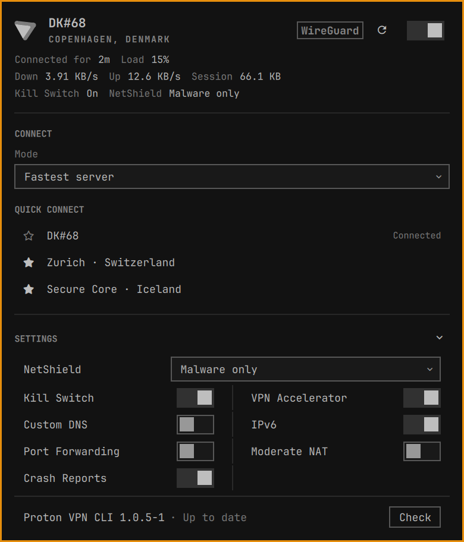

# Proton VPN for Omarchy

<p align="center">
  
  
  
</p>

A bar widget and keyboard-driven panel for Omarchy 4.5 or later that controls Proton VPN through Proton's official Linux CLI, `protonvpn`. Every connection and setting change goes through that CLI. The plugin does not reimplement Proton protocols, call Proton's private APIs, handle your credentials, or edit Proton's files, and the only network request of its own is the update check you start from the panel. [Privacy](docs/privacy.md) lists exactly what it runs.

## What it does

- Connects to the fastest server, or by country, city, server ID, Secure Core, P2P, Tor, or a random server.
- Switches servers in place while connected. **QUICK CONNECT** lists your starred favorites and recent places by name, so you can return to one in a click.
- Shows how long you have been connected, and live download and upload rates and session totals while the panel is open.
- Changes every setting `protonvpn config` exposes, including Kill Switch while connected, after asking first.
- Says under the status what protects you: Kill Switch, NetShield, and Secure Core, as Proton reports them.
- Shows when Kill Switch is blocking internet traffic after a drop, so a dead connection is never a mystery.
- Warns when the tunnel is up but nothing comes back through it, which a plain "connected" hides.
- Checks, from local routing and DNS state, that IPv4, IPv6, and DNS really go through the tunnel, and warns when something else, such as a Tailscale exit node or another DNS server, takes them.
- Sends a desktop notification when the VPN drops while the panel is closed; clicking it opens the panel. It can also reconnect for you, connect when you log in, and connect on Wi-Fi networks you have not trusted.
- Installs the CLI and signs you in from the panel, through Omarchy's own terminal windows, and signs you out again after asking.
- Shows the installed CLI version, and the newer one when your package database knows it, checks your Arch mirrors when you ask, and opens Omarchy's system update when there is a newer one.
- Follows your Omarchy theme and language, and the panel works entirely from the keyboard.

## What you need

- Omarchy 4.5 or later, which provides the translation catalogs the panel reads.
- The official Proton VPN CLI, `proton-vpn-cli`, signed in to your Proton account. See [Install the Proton VPN CLI](#install-the-proton-vpn-cli).
- NetworkManager, Python 3 at `/usr/bin/python3`, `which`, and `wl-clipboard`, all normally present on Omarchy. Without Python 3 no command can run.

## Install

Omarchy plugins run unsandboxed with your user privileges. Review the repository before enabling it.

### From the Omarchy menu

1. Choose **Setup → Plugins → Add Plugin**.
2. When asked for the git URL, enter this and nothing else:

   ```
   https://github.com/BVisagie/omarchy-protonvpn.git
   ```

3. Accept Omarchy's plugin warning. Omarchy clones and validates the plugin, then asks whether to enable it and which bar section to use. Right is preselected.

### From a terminal

```sh
omarchy plugin add https://github.com/BVisagie/omarchy-protonvpn.git
```

Omarchy shows the same warning, clones and validates the plugin, and asks whether to enable it. Add `--enable` to skip that question. Answer no to inspect the checkout at `~/.config/omarchy/plugins/io.github.BVisagie.protonvpn/` first, then enable it:

```sh
omarchy plugin enable io.github.BVisagie.protonvpn --section right
```

Without `--section`, the widget goes to the right section. To move it later:

```sh
omarchy bar move io.github.BVisagie.protonvpn --section center
```

### Install the Proton VPN CLI

When the CLI is missing, the panel offers **Install Proton VPN CLI**. It opens Omarchy's installer in a floating terminal, which installs the package and asks for your password there. You can run the same installer yourself:

```sh
omarchy install app "Proton VPN CLI" proton-vpn-cli
```

`proton-vpn-cli` is in Arch's `extra` repository. Proton publishes an [Arch guide](https://protonvpn.com/support/linux-vpn-arch) for it, but a community contributor maintains the package, and Proton says support for Arch may be limited while it works towards official support. This plugin does not claim official Arch support.

Then sign in. When signed out, the panel offers **Sign in**, which opens a floating terminal that asks for your username and runs `protonvpn signin` with it. The CLI then asks for your password and 2FA itself; the panel never sees them. Or run it yourself:

```sh
protonvpn signin USERNAME
```

On CLI 1.0.5, an account with a security key is asked to touch the key. Add `--totp` to use an authenticator app or recovery code instead. The panel checks every few seconds while the terminal is open and updates once the install or sign-in finishes.

## Update

```sh
omarchy plugin update io.github.BVisagie.protonvpn
```

Omarchy shows the incoming changes and asks before applying them. It then fast-forwards the checkout, validates it, and rolls back if validation fails. The Omarchy menu has no update entry, so updates run from a terminal.

## Uninstall

Choose **Setup → Plugins → Remove Plugin** from the Omarchy menu, then select this plugin. Or from a terminal:

```sh
omarchy plugin remove io.github.BVisagie.protonvpn
```

This removes the plugin from Omarchy. It does not uninstall `proton-vpn-cli` or sign out of Proton VPN.

## Privacy

The plugin runs a fixed set of local commands, never through a shell and never as root, and it never handles your Proton credentials. Its only network request of its own is **Check** in SETTINGS, which asks your Arch mirrors when you press it. Favorites, and recent places with `rememberRecent` on, are saved in this widget's entry in `~/.config/omarchy/shell.json`.

Omarchy plugins run unsandboxed inside the long-lived `omarchy-shell` process with your user privileges. Review the code before enabling it. [docs/privacy.md](docs/privacy.md) lists everything the plugin reads, stores, and runs.

## Documentation

- [Using the panel](docs/usage.md): keys, CONNECT, QUICK CONNECT, SETTINGS, languages, widget settings, and IPC keybindings
- [Privacy](docs/privacy.md): what the plugin reads, stores, and runs
- [Troubleshooting](docs/troubleshooting.md): fixes for common failures, and known limitations
- [Development](docs/development.md): how the plugin is built, its checks, and the release checklist

## License

MIT. See [LICENSE](LICENSE).

Release history is recorded in [CHANGELOG.md](CHANGELOG.md).
