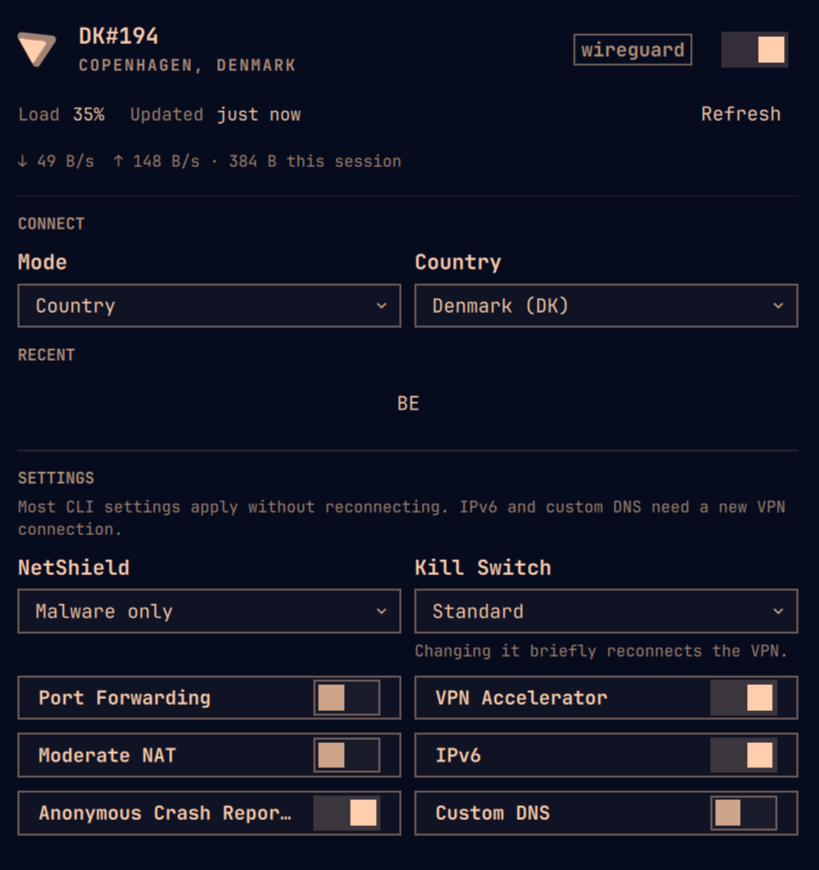
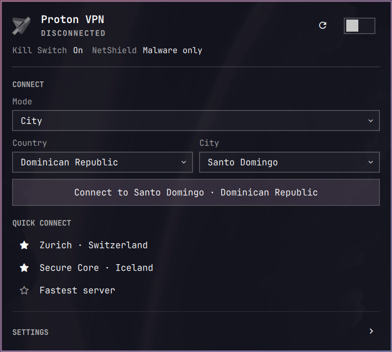
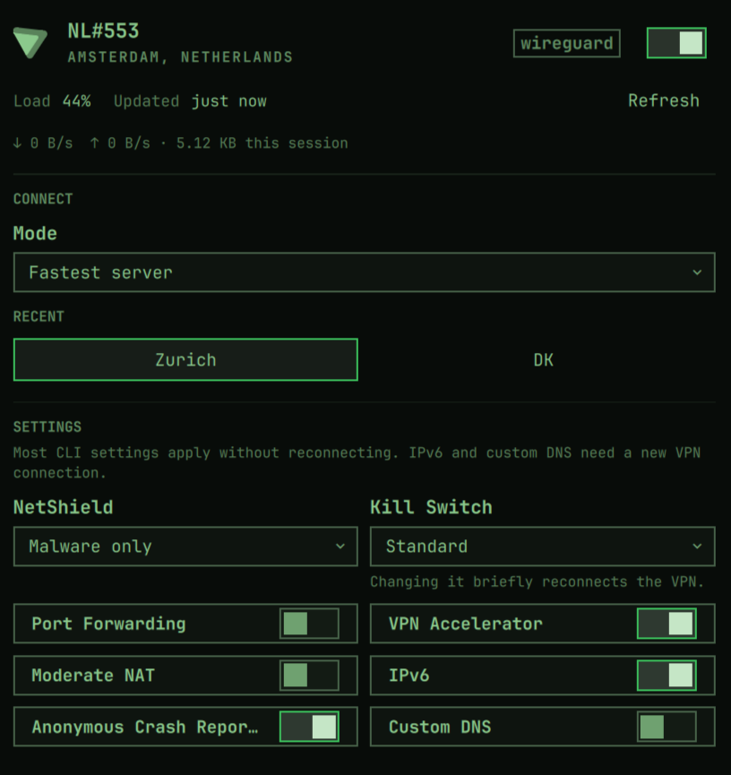

# Proton VPN for Omarchy

<p align="center">
  
  
  
</p>

A bar widget and keyboard-driven panel for Omarchy 4.5 or later that controls Proton VPN through Proton's official Linux CLI, `protonvpn`. Every connection and setting change goes through that CLI. The plugin does not reimplement Proton protocols, call Proton's private APIs, handle your credentials, or edit Proton's files, and the only network request of its own is the update check you start from the panel. [Privacy](#privacy) lists exactly what it runs.

## What it does

- Connects to the fastest server, or by country, city, server ID, Secure Core, P2P, Tor, or a random server.
- Switches servers in place while connected. **QUICK CONNECT** lists your starred favorites and recent places by name, so you can return to one in a click.
- Shows how long you have been connected, and live download and upload rates and session totals while the panel is open.
- Changes every setting `protonvpn config` exposes, including Kill Switch while connected, after asking first.
- Says under the status what protects you: Kill Switch, NetShield, and Secure Core, as Proton reports them.
- Shows when Kill Switch is blocking internet traffic after a drop, so a dead connection is never a mystery.
- Warns when the tunnel is up but nothing comes back through it, which a plain "connected" hides.
- Sends a desktop notification when the VPN drops while the panel is closed; clicking it opens the panel. It can also reconnect for you, connect when you log in, and connect on Wi-Fi networks you have not trusted.
- Installs the CLI and signs you in from the panel, through Omarchy's own terminal windows, and signs you out again after asking.
- Follows your Omarchy theme and language, and the panel works entirely from the keyboard.

## What you need

- Omarchy 4.5 or later, which provides the translation catalogs the panel reads.
- The official Proton VPN CLI, `proton-vpn-cli`, signed in to your Proton account. See [Install the Proton VPN CLI](#install-the-proton-vpn-cli).
- NetworkManager, Python 3 at `/usr/bin/python3`, `which`, and `wl-clipboard`, all normally present on Omarchy. Without Python 3 no command can run.

## Install

Omarchy plugins run unsandboxed with your user privileges. Review the repository before enabling it.

### From the Omarchy menu

1. Choose **Setup → Plugins → Add Plugin**.
2. When asked for the git URL, enter this and nothing else:

   ```
   https://github.com/BVisagie/omarchy-protonvpn.git
   ```

3. Accept Omarchy's plugin warning. Omarchy clones and validates the plugin, then asks whether to enable it and which bar section to use. Right is preselected.

### From a terminal

```sh
omarchy plugin add https://github.com/BVisagie/omarchy-protonvpn.git
```

Omarchy shows the same warning, clones and validates the plugin, and asks whether to enable it. Add `--enable` to skip that question. Answer no to inspect the checkout at `~/.config/omarchy/plugins/io.github.BVisagie.protonvpn/` first, then enable it:

```sh
omarchy plugin enable io.github.BVisagie.protonvpn --section right
```

Without `--section`, the widget goes to the right section. To move it later:

```sh
omarchy bar move io.github.BVisagie.protonvpn --section center
```

### Install the Proton VPN CLI

When the CLI is missing, the panel offers **Install Proton VPN CLI**. It opens Omarchy's installer in a floating terminal, which installs the package and asks for your password there. You can run the same installer yourself:

```sh
omarchy install app "Proton VPN CLI" proton-vpn-cli
```

`proton-vpn-cli` is in Arch's `extra` repository. Proton publishes an [Arch guide](https://protonvpn.com/support/linux-vpn-arch) for it, but a community contributor maintains the package, and Proton says support for Arch may be limited while it works towards official support. This plugin does not claim official Arch support.

Then sign in. When signed out, the panel offers **Sign in**, which opens a floating terminal that asks for your username and runs `protonvpn signin` with it. The CLI then asks for your password and 2FA itself; the panel never sees them. Or run it yourself:

```sh
protonvpn signin USERNAME
```

On CLI 1.0.5, an account with a security key is asked to touch the key. Add `--totp` to use an authenticator app or recovery code instead. The panel checks every few seconds while the terminal is open and updates once the install or sign-in finishes.

## Update

```sh
omarchy plugin update io.github.BVisagie.protonvpn
```

Omarchy shows the incoming changes and asks before applying them. It then fast-forwards the checkout, validates it, and rolls back if validation fails. The Omarchy menu has no update entry, so updates run from a terminal.

## Uninstall

Choose **Setup → Plugins → Remove Plugin** from the Omarchy menu, then select this plugin. Or from a terminal:

```sh
omarchy plugin remove io.github.BVisagie.protonvpn
```

This removes the plugin from Omarchy. It does not uninstall `proton-vpn-cli` or sign out of Proton VPN.

## Using the panel

- **Left-click** the bar icon to open or close the panel.
- **Right-click** connects or disconnects only while status is healthy and idle. Otherwise it opens the panel.
- **Middle-click** refreshes when no Proton command is running.
- The bar icon uses theme colors: connected is full strength, disconnected is dimmed, and degraded states add a warning badge. A slash marks disconnected or signed-out. Tooltip text names the current state.

Inside the panel:

- `j` / `k` or up/down arrows move the cursor between rows
- `h` / `l` or left/right arrows move the cursor across a row
- `Enter` / `Space` activates the selected control
- `t` toggles connect/disconnect with the same safety gate as right-click
- `s` shows or hides SETTINGS, which starts folded so the panel opens on status and CONNECT
- `r` refreshes
- `Tab` / `Shift+Tab` switches to the next bar panel
- `Esc` closes

CONNECT has Mode on its own row and the place, Country and City or a Server ID, on the row below. While disconnected, a button under them names where it connects (**Connect to Santo Domingo · Dominican Republic**). While connected, changing the choices turns it into **Switch to …**, which reconnects in place with the new choices; `Enter` in the Server ID field does the same. The header toggle and `t` still disconnect. City lists are cached for the shell session, so picking a country again shows its cities immediately; the refresh icon beside the toggle reloads them, and its tooltip says when status was last updated.

**QUICK CONNECT** lists, by full name ("Zurich · Switzerland"), the current connection, your favorites, and the last three places you connected to. Click a row, or press `Enter` on it, to connect there. Click its star, or press `f` on the row, to keep it as a favorite or remove it. Favorites, up to eight, are saved in this widget's entry in `~/.config/omarchy/shell.json`. Recent places stay in memory for the shell session unless you turn on `rememberRecent`, which also saves them there and starts CONNECT on the last one; turning it off removes them again. When the CLI supplies a new exit IP after connecting, the panel shows it until the tunnel disconnects or changes.

Country and city lists come from `protonvpn countries list` and `protonvpn cities list`. Server IDs are entered as text because the CLI does not expose a machine-readable server list; Proton publishes IDs at [the account WireGuard server list](https://account.proton.me/vpn/WireGuard).

Settings cover every value exposed by `protonvpn config` on the tested CLI 1.0.1–1.0.5 range: NetShield, Kill Switch, port forwarding, custom DNS, VPN Accelerator, moderate NAT, IPv6, and anonymous crash reports. Changing Kill Switch while connected asks first, with Cancel selected. Confirming disconnects, changes the setting, and reconnects to the same target. If Proton rejects the change, the panel still reconnects and shows the error. IPv6 and custom DNS need a new VPN connection to apply. Custom DNS is validated locally and passed as one `--dns` argument.

With Kill Switch on, a drop leaves internet traffic blocked until the VPN reconnects. The panel reads that from NetworkManager's active connections: the bar icon turns urgent and the panel says traffic is blocked, so you know to connect again or turn Kill Switch off.

With port forwarding on, the panel repeats what the CLI says after connecting: whether the server supports it. The CLI does not show the forwarded port. Proton's [Linux port-forwarding guide](https://protonvpn.com/support/port-forwarding-manual-setup) reads it with `natpmpc`, and this plugin does not run that for you, because it would be a network request of its own.

On Proton's free plan the CLI only connects to the fastest server. When `protonvpn config list` marks settings "Upgrade to enable", the panel labels the other modes as needing a paid plan and explains that instead of running a command that would fail. A Kill Switch change or an automatic reconnect then returns to the fastest server.

While disconnected, the bottom of SETTINGS offers **Sign out**. It asks first, with Cancel selected, then runs `protonvpn signout`, which also clears the CLI's own settings. Favorites stay. Disconnect first if you are connected.

The bottom of SETTINGS shows the installed Proton VPN CLI version and the latest one your package database knows, with how old that database is. It reads that locally. **Check** asks your Arch mirrors instead, through pacman's `checkupdates`, only when you press it. When a newer version exists, **Update** opens Omarchy's own system update in a terminal, which asks for your password there; Arch does not support updating one package alone, so the CLI updates with everything else.

Some rows show a short caption. Hover a CONNECT or SETTINGS control, or move onto it with `j` / `k`, for a Proton-sourced tooltip. That copy is paraphrased from Proton’s official support articles and the Linux CLI guide. It is not a substitute for those pages, and the widget does not fetch Proton’s website.

## Languages

The panel follows **Setup → Language** live, without a shell restart. Its strings live in `i18n/`, one JSON catalog per Omarchy language code. Only English ships today; a missing string falls back to English. To add a language, copy `i18n/en.json` to the language's code (for example `i18n/de.json`) and translate the values, keeping each `%1` placeholder. Proton CLI output, server names, and diagnostics stay as the CLI wrote them.

After changing a string in the code, run `node tests/tools/build_catalog.js` to rewrite `i18n/en.json`; the tests fail until it matches.

## Widget settings

| Setting | Key | Default | Range or values |
|---|---|---|---|
| Status refresh while the panel is open | `refreshIntervalSec` | 30 seconds | 10–3600 |
| Link check interval when NetworkManager events are unavailable | `linkWatchIntervalSec` | 4 seconds | 2–60 |
| Desktop notifications (only while the panel is closed) | `notifications` | `drops` | `off`, `drops`, `all` |
| Reconnect when the VPN drops | `reconnectOnDrop` | `false` | `true`, `false` |
| Remember recent connections and the last target across restarts | `rememberRecent` | `false` | `true`, `false` |
| Connect when you log in | `connectOnLogin` | `false` | `true`, `false` |
| Connect on Wi-Fi networks you have not trusted | `autoConnectWifi` | `false` | `true`, `false` |
| Text beside the bar icon while connected | `barLabel` | `none` | `none`, `country` (NL), `server` (NL#806), `city` (Amsterdam) |

Change a setting with `omarchy bar set`. Numbers and booleans need `--json`:

```sh
omarchy bar set io.github.BVisagie.protonvpn notifications all
omarchy bar set io.github.BVisagie.protonvpn refreshIntervalSec 60 --json
omarchy bar set io.github.BVisagie.protonvpn reconnectOnDrop true --json
omarchy bar set io.github.BVisagie.protonvpn barLabel country
```

The bar label shows only while connected, and only on horizontal bars.

With `connectOnLogin` on, the first shell start after you log in connects to the fastest server, or to your last place with `rememberRecent` on. It does not connect when the shell merely reloads, for example after a theme change: the plugin's lock file for the current Hyprland session tells the two apart. It waits for Proton to report Disconnected, checking every 10 seconds for up to 3 minutes while the network and Proton's services come up, and tries at most 3 times. Connecting or disconnecting yourself in that time cancels it, and it never runs while you are signed out. With Kill Switch on, a network that needs a sign-in page (a captive portal) may not let it through until you disconnect.

With `autoConnectWifi` on, joining a Wi-Fi network you have not trusted connects the same way, once per join, with the same waiting, limits, and cancelling. SETTINGS then shows **Trust** for the current network, which skips it from then on, or **Stop trusting**. Trusted names are saved as `trustedNetworks` in this widget's entry in `~/.config/omarchy/shell.json`. The plugin reads the current network from NetworkManager over D-Bus, through Quickshell, without starting a process. It never disconnects on a trusted network, a shell reload never counts as joining one, and a network whose name NetworkManager does not report counts as trusted. Sign in to a captive portal before you join it with Kill Switch on, or trust it.

A drop is any tunnel loss the widget did not start itself, including one from another terminal. `all` also notifies when the tunnel connects. Notifications go through `omarchy-notification-send`; clicking one opens the panel.

With `reconnectOnDrop` on, a drop starts a reconnect to the same target after 3 seconds, then retries after 10 seconds, 30 seconds, 1 minute, and 2 minutes before giving up with a notification. Connecting or disconnecting from the panel cancels it. The widget follows drops through `nmcli`, so this needs NetworkManager's link probe to work.

### Keybindings

The panel answers Omarchy shell IPC on the target `io.github.BVisagie.protonvpn`:

| Function | What it does |
|---|---|
| `open`, `close`, `toggle` | Show or hide the panel |
| `refresh` | Re-read status, locations, and settings |
| `connectVpn` | Connect with the panel's current CONNECT choices |
| `connectFastest` | Connect to the fastest server |
| `connectTo <place>` | Connect to `NL`, `CH#242`, `US New York`, `p2p`, `securecore`, or `tor` with an optional country code (`p2p NL`), or `random` or `fastest` |
| `disconnectVpn` | Disconnect |
| `toggleVpn` | Connect or disconnect, like right-click |
| `status` | The tooltip text |
| `statusJson` | State, server, location, load, protocol, exit IP, connection start, Kill Switch, NetShield, and warnings as JSON |

The connect and disconnect functions do nothing while a command is running or status is not healthy; `connectFastest` and `connectTo` print why. For example, in `~/.config/hypr/bindings.conf`, using keys that are free in your setup:

```
bindd = SUPER ALT, V, Proton VPN panel, exec, omarchy-shell io.github.BVisagie.protonvpn toggle
bindd = SUPER ALT SHIFT, V, Proton VPN connect, exec, omarchy-shell io.github.BVisagie.protonvpn connectVpn
bindd = SUPER ALT CTRL, V, Proton VPN to Switzerland, exec, omarchy-shell io.github.BVisagie.protonvpn connectTo CH
```

`statusJson` suits scripts and status lines:

```sh
omarchy-shell io.github.BVisagie.protonvpn statusJson | jq -r .server
```

## Privacy

- The plugin executes a fixed set of local commands as argument arrays. It never interpolates values into a shell. See [Commands this plugin runs](#commands-this-plugin-runs).
- The runner caps stdout and stderr while commands execute, enforces deadlines, and reaps the complete child process group after a timeout or overflow, or when a background process the command left behind still holds its output.
- Proton CLI runs take a lock in your runtime directory (`$XDG_RUNTIME_DIR/omarchy-protonvpn-<Hyprland session>.lock`, or `omarchy-protonvpn.lock` outside Hyprland), so two shells never run the CLI at the same time. The lock file is empty, and a new one per login also tells the widget a login from a shell reload.
- A read-only `nmcli monitor` stream says when NetworkManager changes anything, and a read-only `nmcli connection show --active` probe then reads the `proton0`-style tunnel. With the stream running, the probe otherwise runs once a minute; without it, every `linkWatchIntervalSec`. Neither creates, changes, or removes NetworkManager connections.
- It never collects, logs, stores, or passes Proton credentials. The sign-in terminal passes only your username to the CLI.
- It never runs anything as root. Installing or updating the CLI goes through Omarchy's installer or system update, each of which asks for your password in its own terminal.
- It never makes extra network requests such as “what is my IP” lookups, map tiles, or telemetry. The one exception is **Check** in SETTINGS, which runs pacman's `checkupdates` against your Arch mirrors only when you press it.
- The exit IP is shown only when the Proton CLI itself returns it after connecting. Exit IP and traffic totals stay in memory and disappear when `omarchy-shell` exits.
- Quickshell keeps the name of the Wi-Fi network you are on in memory, from NetworkManager. The plugin acts on it only with `autoConnectWifi` on, and saves the names you trust in its `shell.json` entry.
- Favorites, and recent places only with `rememberRecent` on, are saved as connection choices (mode, country code, city, server ID) in this widget's own entry in `~/.config/omarchy/shell.json`, through Omarchy's plugin API. If you keep your dotfiles in a public repository, that file shows where you connect.
- Traffic rates come from the tunnel's own kernel counters under `/sys/class/net/`. While the tunnel is up they are read every two seconds with the panel open and every five seconds with it closed, for the stall warning; rates are shown only in the open panel. Reading them starts no process. Captured test fixtures are synthetic or redacted.
- Raw CLI diagnostics are capped before they are shown.

Omarchy plugins run unsandboxed inside the long-lived `omarchy-shell` process with your user privileges. This plugin invokes `protonvpn` only after discovering it on `PATH`. Review the code before enabling it.

### Commands this plugin runs

Supervised by `scripts/run_bounded.py`, which caps output, enforces a deadline, and cleans up the process group. `protonvpn` runs also take the lock above:

- `/usr/bin/which protonvpn` to find the CLI
- `protonvpn` subcommands: `--help`, `status`, `connect`, `disconnect`, `countries list`, `cities list`, `config list`, `config set`, and `signout`
- `/usr/bin/nmcli -t -e no -f NAME,TYPE,DEVICE,STATE,TIMESTAMP connection show --active`
- `/usr/bin/pacman -Q proton-vpn-cli`, `/usr/bin/pacman -Sddp --print-format "%n %r %v" proton-vpn-cli`, and `/usr/bin/stat -c %Y /var/lib/pacman/sync/<repo>.db`, local reads of the installed and latest known CLI version, at most once a minute when the panel opens
- `/usr/bin/checkupdates --nocolor`, only when you press **Check**; it asks your Arch mirrors in a temporary database of its own

Read in place, without starting a process: `/sys/class/net/<device>/statistics/rx_bytes` and `tx_bytes`, only for a `proton0`-style device.

Started directly and kept running while the widget is loaded, with its output read one line at a time and discarded:

- `/usr/bin/nmcli monitor`, restarted with a backoff of up to a minute if it exits

Started directly, only when you press the matching panel control:

- `wl-copy` copies the suggested sign-in command
- `omarchy-launch-floating-terminal-with-presentation omarchy-update` opens Omarchy's system update when you press **Update**
- `omarchy-install-app "Proton VPN CLI" proton-vpn-cli` opens Omarchy's installer in a floating terminal
- `omarchy-launch-floating-terminal-with-presentation` with one fixed script, `read -rp 'Proton username: ' u && protonvpn signin -- "$u"`, for signing in. The script contains no values from the plugin.

Started directly when the tunnel changes while the panel is closed:

- `omarchy-notification-send` sends a fixed desktop notification when the tunnel drops (or connects, if enabled), or when an automatic reconnect gives up. CLI-supplied server names only ever follow fixed text in the body. Clicking it runs `omarchy-shell io.github.BVisagie.protonvpn open`.

## Limitations

- The official CLI cannot run at the same time as the Proton VPN desktop app. Close the GUI to use this widget.
- Headless setups and split tunneling are not supported by the CLI, so they are out of scope here.
- Location, feature, and some configuration choices can require a paid plan. The CLI does not report the plan, so the panel infers the free plan only from settings marked "Upgrade to enable". Until settings load, it shows the CLI's error instead.
- Reconnect on drop cannot tell a drop from a `protonvpn disconnect` typed in another terminal, so with it on, that disconnect is undone. Disconnect from the panel instead, or leave the setting off.
- `protonvpn status` does not provide the current exit IP. The widget never performs an external lookup, so the value is available only after a successful connect command that returned it.
- Omarchy creates a widget on each monitor. On Omarchy's built-in bar every panel uses one shared service, so Proton CLI commands are serialized across all monitors. Replacement bars cannot provide that service, so each panel there runs its own copy and polls separately.
- `protonvpn status` runs on a timer only while a panel is open. Each run starts Python and opens a new keyring connection, so with every panel closed it runs only at start-up, when the NetworkManager link changes, and after an action. If `nmcli` is unavailable, it keeps polling on the timer. The bar icon keeps following the tunnel through the read-only link probe, but a sign-out or a newly opened desktop app is noticed only when you open the panel or the link changes.
- The Proton CLI sometimes crashes while exiting, after printing its full output. Read-only commands (`status`, `countries list`, `cities list`, `config list`) accept that output when it parses. Settings must list every known key, and country or city lists from a crashed run are fetched again next time. Connect, disconnect, and setting changes never do.
- Desktop notifications are never sent while the panel is open.
- Changing Kill Switch while connected leaves you unprotected for a few seconds during the reconnect. That is why the panel asks first.

## Troubleshooting

Confirm the Proton CLI itself before assuming a widget bug. These failures belong to Proton, Arch packaging, or the local session:

```sh
pacman -Q proton-vpn-cli
protonvpn --help
protonvpn status
protonvpn countries list
```

The recorded parser fixtures target CLI versions 1.0.1 through 1.0.5. Versions outside that range receive a non-blocking compatibility warning; malformed status output still activates the existing stale-state safety gate.

**CLI not installed.** Choose **Install Proton VPN CLI** in the panel, or run `omarchy install app "Proton VPN CLI" proton-vpn-cli`. The bar tooltip reads “Proton VPN CLI not installed.”

**Sign-in required.** Choose **Sign in** in the panel, or run `protonvpn signin USERNAME` in a terminal. With a security key on CLI 1.0.5, add `--totp` to use an authenticator code instead.

**No internet after a drop.** If the panel says Kill Switch is blocking traffic, that is Kill Switch working. Connect again, or set Kill Switch to Off.

**Desktop app is running.** Quit the Proton VPN GUI. The CLI refuses to operate until it is closed.

**Keyring or Secret Service failure.** The CLI could not read saved credentials from the session keyring. Unlock or restart the keyring, then run `protonvpn status` in a terminal. The widget reports this as a local session error, not as signed-out and not as a parser bug.

**Daemon unavailable.** `proton-vpn-daemon` did not respond. Check the Proton CLI service, then refresh. This is a Proton CLI/service problem.

**Connection timeout.** `Timed out after 10s waiting for event(s): CONNECTED` means the CLI reached Proton but the handshake did not finish. Retry or check the network. This is separate from the widget's command-queue watchdog.

**"Nothing has come back through the tunnel."** The tunnel has sent data for 30 seconds without receiving any. The Proton server or the network under the VPN may be down. Reconnect, or switch servers. An idle tunnel never shows this, and the warning clears as soon as anything arrives.

**Status looks outdated.** A failed or timed-out poll keeps the last good result and marks it stale. Connection and settings changes stay disabled until a fresh probe succeeds. Refresh after the network or Proton daemon recovers.

**Paid-plan or invalid option.** The panel shows the CLI message, or its own free-plan note, and keeps the previous healthy status when it can. Fastest connect remains available.

**Hung command.** A watchdog stops a stuck process and marks its job timed out. Queued commands start once that process has exited, and its late output is ignored.

**Update says it cannot fast-forward.** If you have not changed the checkout yourself, your copy predates a rewrite of this repository's history in September 2026. Remove the plugin and add it again; see [Uninstall](#uninstall) and [Install](#install).

**Validate the plugin:**

```sh
./scripts/check.sh
```

That script runs Node and Python tests, `omarchy plugin validate .` when Omarchy is installed, a QML contract check, bounded-runner tests, a `qmllint` syntax check, and shell-load smoke tests. The same portable checks run in GitHub Actions. `qmllint` reports many unresolved-import warnings because Quickshell and Omarchy imports only resolve inside `omarchy-shell`. The script ignores those and fails only on syntax errors, so a pass does not prove the widget loads. Test it in the bar before releasing.

## Architecture

- `Service.qml` is the Omarchy service shared by every monitor. It runs Proton CLI commands one at a time and stops a stuck one with a watchdog.
- `Scheduler.js` is the job queue behind it. User actions and city lists go ahead of background refreshes, each job has its own timeout, and output from a job that was already stopped is ignored.
- `Panel.qml` contains the compact bar control and reads state from the shared service. When the bar cannot provide one, it runs a local `Service` instance instead.
- `ProtonVpnIcon.qml` draws the Proton VPN mark in the current theme color for the bar and panel.
- `Model.js` contains parsers, validation, compatibility detection, and display rules covered by captured fixtures.
- `scripts/run_bounded.py` is a local process supervisor and lock; it does not implement VPN behavior or make network requests.
- `i18n/` holds the translation catalogs; `tests/tools/build_catalog.js` regenerates `en.json` from the code.

## License

MIT. See [LICENSE](LICENSE).

Release history is recorded in [CHANGELOG.md](CHANGELOG.md).
